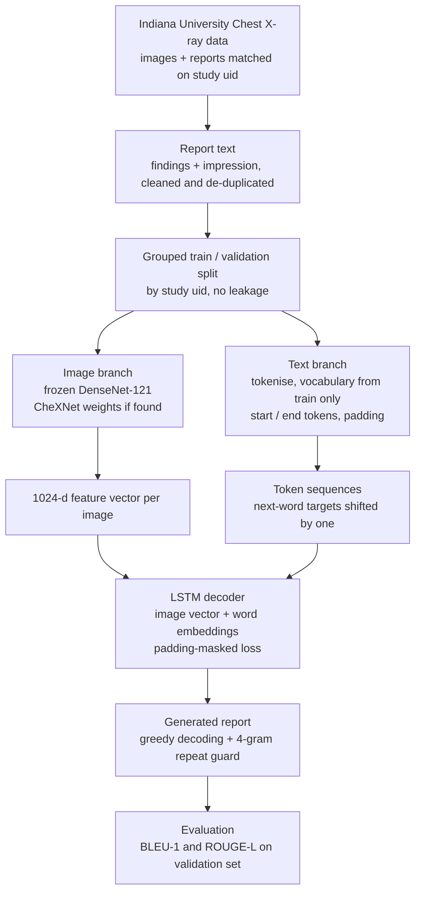

# Chest X-ray Report Generation

A small end-to-end baseline that generates radiology-style text from chest X-rays using a frozen
DenseNet-121 image encoder and an image-conditioned LSTM decoder.

> **Research baseline only. Not for clinical use.**

## Abstract

Writing radiology reports is time-consuming, and automating a first draft is an active research problem. This project builds a compact baseline that generates chest X-ray reports with an image-conditioned decoder. Images and reports from the Indiana University Chest X-ray collection are matched by study ID and split by study to prevent leakage. A frozen DenseNet-121 encoder (initialised with CheXNet weights when available) extracts one feature vector per image, and an LSTM decoder conditioned on those features is trained with a padding-masked cross-entropy loss to predict report text token by token. Reports are generated by greedy decoding with a repeat guard and scored with BLEU-1 and ROUGE-L. The goal is a transparent, reproducible starting point rather than a clinically usable system: the model is small, trained on a subset of the data, and evaluated with word-overlap metrics only.


## Workflow



## Pipeline

1. Match images to reports on the study `uid` (Indiana University Chest X-ray dataset).
2. Grouped train/validation split by `uid` (no study appears in both sets).
3. Extract image features once with a frozen DenseNet-121 (optionally CheXNet-initialised).
4. Tokenise reports; vocabulary built from the training split only.
5. Train an LSTM decoder with a padding-masked cross-entropy loss.
6. Greedy decoding with a 4-gram repeat guard; score with BLEU-1 and ROUGE-L.

## Comparison with the Kaggle reference

See [docs/COMPARISON.md](docs/COMPARISON.md) for a stage-by-stage comparison with the Kaggle notebook this project was based on.

## Data

Download from Kaggle (not included in this repo):

- [Chest X-rays, Indiana University](https://www.kaggle.com/datasets/raddar/chest-xrays-indiana-university)
- [CheXNet weights](https://www.kaggle.com/datasets/sinamhd9/chexnet-weights) (optional)

## Run

**On Kaggle:** attach both datasets to a notebook, upload `chest_xray_report_generation.ipynb`, run all.

**Locally, as a script:**

```bash
pip install -r requirements.txt
python chest_xray_report_generation.py \
    --data-dir /path/to/chest-xrays-indiana-university \
    --chexnet-dir /path/to/chexnet-weights \
    --output-dir ./chest_xray_report_model
```

`--chexnet-dir` is optional. Useful options: `--max-reports 0` (use all pairs), `--epochs`,
`--batch-size`, `--n-eval`. Run `python chest_xray_report_generation.py --help` for the full list.
Outputs (model, vocabulary, metrics, results CSV, training curves) go to `--output-dir`.

**Locally, as a notebook:**

```bash
export DATA_DIR=/path/to/chest-xrays-indiana-university
export CHEXNET_DIR=/path/to/chexnet-weights     # optional
export OUTPUT_DIR=./chest_xray_report_model
jupyter notebook chest_xray_report_generation.ipynb
```

In the notebook, settings are in the first code cell. By default only 500 image/report pairs are
used for quick iteration; set `MAX_REPORTS = None` (script: `--max-reports 0`) to use everything.

## Results

The chest X-ray report-generation model was evaluated on 50 reports, achieving a mean BLEU-1 score of 0.192697 and a mean ROUGE-L score of 0.219235. Sample outputs showed partial textual overlap with reference reports, although generated descriptions sometimes repeated generic findings about cardiac size and the mediastinum. These results provide a preliminary baseline for image-to-report generation; further evaluation is required to assess image-specific findings and clinical accuracy.

## Limitations

- Small decoder trained on a small subset; generated text is generic and can be repetitive.
- BLEU-1 and ROUGE-L measure word overlap, not clinical accuracy.
- If no CheXNet weights are found the encoder is randomly initialised (the notebook prints a warning).
- The dataset anonymises some words as `XXXX`; these are kept as ordinary tokens.

## Acknowledgements

- Xu et al., *Show, Attend and Tell*: https://arxiv.org/abs/1502.03044
- Inspired by Ebrahim Elgazar's Kaggle notebook: https://www.kaggle.com/code/ebrahimelgazar/image-captioning-chest-x-rays
